# Product Discovery Flow — a 15-agent pipeline for Claude Code

> One skill, **12 steps**, **15 sub-agents**. From a raw product brief to a finished, publishable discovery report — built on the **Advanced Jobs To Be Done** methodology by Ivan Zamesin (not generic Christensen JTBD).

🔗 **Live demo (RU / EN):** https://product-discovery.dervlad.com
👤 **Author:** [Uladzislau Dziarkach (Vladislav Derkach)](https://www.linkedin.com/in/vladislavderkach/en/)

---

## What it is

A single Claude Code skill — `/product-discovery` — orchestrates a chain of specialized sub-agents. (It ships in two languages: `/product-discovery` in English and `/product-discovery-ru` in Russian. Same steps, same agents, same rules — only the language you talk to it in differs.) You write a free-form brief; the pipeline structures the request, recovers context from past research, maps the market, reads communities, validates every Job against the AJTBD canon, builds segments, QAs the research, writes the report, QAs the report, and publishes it.

The core principle: **each agent owns strictly its own area.** The orchestrator knows the order, knows where work runs in parallel, and knows the two gates where it must stop and get a human decision.

### It works for any company

Nothing in the pipeline is hard-wired to a particular company, product, industry or tool stack. Everything company-specific lives in **one file** — `~/.claude/discovery-profile.md` — which you fill in once. Every agent reads it.

The profile holds your company and product, your segments, your competitors, your Job Graph anchor, where your reports get published, and **which internal systems you actually have**. Anything you leave as `—` is treated as *"does not exist"*: the agent skips it, records a data gap, and never substitutes a guess. So the flow is useful on day one with an almost-empty profile — the external research half (market map, competitors, communities, trends) runs on web search alone — and gets sharper as you connect more.

On the first run the skill offers to build the profile for you: six questions, or a look at your company's site, or skip it entirely.

---

## The pipeline

```mermaid
flowchart TD
    B0["🪪 Step 0.0 — company profile<br/>(exists → confirm | missing → build or skip)"] --> B
    B["📥 Step 0 — intake<br/>(brief* + author + format + ROI? + destination)"] --> S1
    S1["1 · discovery-request-agent<br/><i>raw brief → structured request</i>"] --> S2
    S2["2 · context-recovery-agent<br/><i>past reports → blind spots</i>"] --> P3

    subgraph P3 ["Step 3 — data collection ∥ parallel"]
        direction LR
        S3a["3a · market-source-map-agent"]
        S3b["3b · product-knowledge-agent"]
        S3c["3c · internal-data-agent"]
    end
    P3 --> P4

    subgraph P4 ["Step 4 — competitive recon ∥ parallel"]
        direction LR
        S4a["4a · feature-intelligence-agent"]
        S4b["4b · community-signal-intelligence-agent"]
        S4c["4c · trend-analyst"]
    end
    P4 --> G5

    G5{"5 · ajtbd-canon-validator<br/>⛔ GATE — BLOCK → stop & fix"} --> S6
    S6["6 · ajtbd-segmentation-agent"] --> S7
    S7["7 · discovery-qa-agent"] --> S8
    S8["8 · internal-data-agent (again)"] --> S9
    S9["9 · market-opportunity-roi-agent<br/><i>optional — skipped by default</i>"] --> S10
    S10["10 · discovery-final-report-agent<br/>→ publish (EN)"] --> G105
    G105{"10.5 · slop-logic-qa-agent<br/>⛔ GATE — HIGH → stop"} --> S11
    S11["11 · report-translation-agent<br/>→ publish (translated)"]
```



---

## The 15 sub-agents

| # | Step | Agent | What it does |
|---|------|-------|--------------|
| 1 | 1 | `discovery-request-agent` | Turns a raw brief into a structured Discovery Request (research question, segments by Job Graph, scope, assumptions). Proposes no solutions. |
| 2 | 2 | `context-recovery-agent` | Reads your past Discovery reports; extracts studied competitors, documented Jobs (re-canon'd), covered segments; returns blind spots. |
| 3 | 3a | `market-source-map-agent` | Maps direct competitors, substitutes, adjacent solutions → segment, Job, primary sources. Returns strict JSON. |
| 4 | 3b | `product-knowledge-agent` | Combs your own help docs + engineering wiki for what the product does today, its limits, what's shipped and planned. The AS-IS baseline. |
| 5 | 3c · 8 | `internal-data-agent` | Queries whatever you have connected — revenue metrics, CRM, team chat, community, product analytics, support. Quant + qual, split by segment. |
| 6 | 4a | `feature-intelligence-agent` | Deep dive on one feature across 2–5 competitors: Core Job, product logic, trade-offs, scale readiness. |
| 7 | 4b | `community-signal-intelligence-agent` | Public signals (Reddit, G2, Capterra, Trustpilot, social): Problems, workarounds, switching and purchase triggers — via the AJTBD lens. |
| 8 | 4c | `trend-analyst` | Weak signals & emerging trends; builds 2–4 scenarios with probability ranges. |
| 9 | 5 · **GATE** | `ajtbd-canon-validator` | Checks every Job / level / success criterion against Zamesin's canon. `PASS` / `BLOCK`. On BLOCK the pipeline stops. |
| 10 | 6 | `ajtbd-segmentation-agent` | Builds the Job Graph (Big → Core → Small → Micro), clusters segments by Job Graph + criteria similarity, scores them. |
| 11 | 7 | `discovery-qa-agent` | Audits research quality, raises flags, produces extra analytics queries + a manual PM to-do. |
| 12 | 9 · opt. | `market-opportunity-roi-agent` | TAM/SAM/SOM two ways, audience funnel, competitor pricing, segment economics. Skipped by default. |
| 13 | 10 | `discovery-final-report-agent` | Formats approved findings into a 3-layer, 11-section report. Invents nothing. |
| 14 | 10.5 · **GATE** | `slop-logic-qa-agent` | Catches AI slop + logic inconsistencies with quotes and HIGH/MED/LOW severity. On HIGH the pipeline stops. |
| 15 | 11 | `report-translation-agent` | Translates the final report into the language set in your profile, preserving structure. Skipped if none. |

All 15 agents run in English. Job statements follow the canonical AJTBD form `I want to + infinitive verb` (the canon's own Russian phrasing, `Я хочу + инфинитив глагола`, is quoted where the rule is defined).

Full source of every agent lives in [`files/agents/`](files/agents), the orchestrator skill in [`files/skill/SKILL.md`](files/skill/SKILL.md), the profile template in [`files/profile/`](files/profile).

---

## Install

Three ways in. **Option A is the recommended one** — it installs the whole thing as a Claude Code plugin, keeps it updatable with one command, and touches nothing in your home directory.

### Option A — as a Claude Code plugin (recommended)

Inside Claude Code:

```
/plugin marketplace add VladislavDerkach/product-discovery-flow
/plugin install product-discovery-flow@dervlad
```

That gives you both orchestrator skills and all 15 sub-agents, namespaced under the plugin:

- `/product-discovery-flow:product-discovery` — English orchestrator
- `/product-discovery-flow:product-discovery-ru` — Russian orchestrator
- the 15 sub-agents as `product-discovery-flow:<agent-name>`

Update later with `/plugin update product-discovery-flow`; remove with `/plugin uninstall product-discovery-flow`.

You still need the company profile: copy [`files/profile/discovery-profile.template.md`](files/profile/discovery-profile.template.md) to `~/.claude/discovery-profile.md` and fill it in, or just run the skill and let it interview you.

### Options B and C — copy the files into `~/.claude/`

These put the sub-agents in `~/.claude/agents/*.md` and the skills in `~/.claude/skills/product-discovery/SKILL.md` (English) and `~/.claude/skills/product-discovery-ru/SKILL.md` (Russian), so the commands come out unprefixed: `/product-discovery` and `/product-discovery-ru`.

### Option B — git clone

```bash
git clone https://github.com/VladislavDerkach/product-discovery-flow.git
cd product-discovery-flow
bash install-local.sh
```

### Option C — one-line remote installer

```bash
curl -fsSL https://product-discovery.dervlad.com/install.sh | bash
```

Both B and C create `~/.claude/agents` plus both skill directories, drop the files in, and copy the profile template and example to `~/.claude/`. An existing `~/.claude/discovery-profile.md` is never overwritten. Nothing else on your system is touched.

Then: **restart Claude Code**, check `/agents` (15 new ones should appear), and run:

```
/product-discovery
```

…or inline: `/product-discovery figure out whether we should build X for segment Y`.

For the Russian-language orchestrator, use `/product-discovery-ru` instead. The agents themselves write in English by default in both cases — set a translation language in the profile if you also want a translated copy of the final report.

---

## The company profile

One file, `~/.claude/discovery-profile.md`. Fill it once; every agent reads it.

| Section | What it drives |
|---|---|
| 1 · Company and product | The product name in every report; geography and pricing for market sizing |
| 2 · Strategic narrative | Whether Step 7 can judge strategic fit at all |
| 3 · Target segments | Which segments the research must cover; which legacy ones must never be blended in |
| 4 · Competitors | Starting list for the market map and for pricing research |
| 5 · Job Graph anchor | What Core / Big / Small / Micro *mean* — the levels are relative to **your** product's reach |
| 6 · Data sources | Which internal systems exist. `not configured` = skipped and reported, never guessed |
| 7 · Publishing target | Where reports go, and whether a translation runs |
| 8 · Readers | Depth and tone of the final report |

Start from [`files/profile/discovery-profile.template.md`](files/profile/discovery-profile.template.md). A fully worked example on a made-up company is in [`files/profile/discovery-profile.example.md`](files/profile/discovery-profile.example.md).

**Never put secrets in the profile** — links and names only, no API keys or tokens.

---

## Dependencies

`WebSearch` / `WebFetch` are built into Claude Code — six of the fifteen agents need nothing else. The rest are MCP connectors for **your own** systems, authorized via `/mcp` or your claude.ai connector settings. Without them, the relevant steps report a data gap; the pipeline does not break.

| Dependency | Needed by | Status |
|---|---|---|
| `WebSearch` / `WebFetch` | Market & Source Map, Feature Intelligence, Community Signals, `trend-analyst`, Segmentation, ROI | built-in |
| A wiki / docs connector (Notion, Confluence, …) | Context Recovery, Product Knowledge, publishing in Final Report and Translation | connect if you have one |
| Revenue · CRM · chat · analytics · support connectors | `internal-data-agent` (steps 3c & 8) | connect what you have |
| `Firecrawl` (optional) | Context Recovery, Product Knowledge — otherwise falls back to WebFetch | optional |
| Next Move Theory canon on disk | `ajtbd-canon-validator` reads the canon before validating — without it, it refuses to run rather than validate from memory | required for step 5 |

Get the canon: [github.com/zamesin/Next-Move-Theory-Canon-and-Skills](https://github.com/zamesin/Next-Move-Theory-Canon-and-Skills). Point the profile's section 6 at it, or install it to `~/Next-Move-Theory-Canon-and-Skills/`.

---

## Repo structure

```
product-discovery-flow/
├── README.md
├── LICENSE
├── .claude-plugin/
│   ├── plugin.json           # the Claude Code plugin manifest
│   └── marketplace.json      # lets this repo be added as a marketplace
├── install-local.sh          # installs from this clone into ~/.claude/
├── install.sh                # remote installer (curl | bash)
├── index.html                # the live showcase site (RU/EN)
├── vercel.json
└── files/
    ├── skill/SKILL.md        # the /product-discovery orchestrator (English)
    ├── skill-ru/SKILL.md     # the /product-discovery-ru orchestrator (Russian)
    ├── agents/*.md           # the 15 sub-agents
    └── profile/              # company profile template + worked example
```

---

## Methodology note

This is **Ivan Zamesin's Advanced JTBD**, not generic Christensen JTBD. A Job is the spec of a State A → State B transition, phrased as *"I want to + verb"*, with levels **Big → Core → Small → Micro** where **Small is a sibling of Core**, not a step beneath it — and where the levels are always relative to *your* product's reach, which is exactly why the profile has a Job Graph anchor. The Canon Validator agent exists specifically to keep every output on-canon. Learn more at [nextmovetheory.com](https://nextmovetheory.com).

---

## License

[MIT](LICENSE) © 2026 Uladzislau Dziarkach (Vladislav Derkach) · [LinkedIn](https://www.linkedin.com/in/vladislavderkach/en/)
