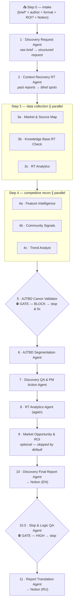

# Product Discovery Flow — a 15-agent pipeline for Claude Code

> One skill, **12 steps**, **15 sub-agents**. From a raw product brief to a finished, bilingual Notion report — built on the **Advanced Jobs To Be Done** methodology by Ivan Zamesin (not generic Christensen JTBD).

🔗 **Live demo (RU / EN):** https://rt-discovery-flow.vercel.app
👤 **Author:** [Uladzislau Dziarkach (Vladislav Derkach)](https://www.linkedin.com/in/vladislavderkach/en/)

---

## What it is

A single Claude Code skill — `/rt-product-discovery` — orchestrates a chain of specialized sub-agents. You write a free-form brief; the pipeline structures the request, recovers context from past research, maps the market, reads communities, validates every Job against the AJTBD canon, builds segments, QAs the research, writes the report, QAs the report, and publishes it to Notion in English and Russian.

The core principle: **each agent owns strictly its own area.** The orchestrator knows the order, knows where work runs in parallel, and knows the two gates where it must stop and get a human decision.

Originally built for **RedTrack**'s product team — so several agents reach into a specific Notion / Slack / ChartMogul / HubSpot / Telegram workspace. Anyone can install and run it; agents that use only web search work out of the box, the rest need the matching connectors (see [Dependencies](#dependencies)).

---

## The pipeline



---

## The 15 sub-agents

| # | Step | Agent | What it does |
|---|------|-------|--------------|
| 1 | 1 | **Discovery Request Agent** | Turns a raw brief into a structured Discovery Request (research question, segments by Job Graph, scope, assumptions). Proposes no solutions. |
| 2 | 2 | **Context Recovery RT Agent** | Reads past Discovery reports in Notion; extracts studied competitors, documented Jobs (re-canon'd), covered segments; returns blind spots. |
| 3 | 3a | **Market & Source Map Agent** | Maps direct competitors, substitutes, adjacent solutions → segment, Job, primary sources. Returns strict JSON. |
| 4 | 3b | **Knowledge Base RT Check Agent** | Combs help.redtrack.io + the Notion Development section for features, limits, what's shipped/planned. |
| 5 | 3c · 8 | **RT Analytics Agent** | Pulls ChartMogul (MRR/churn/ARPA/LTV), HubSpot (deals, win/loss), Slack, Telegram. Quant + qual slice by segment. |
| 6 | 4a | **Feature Intelligence Agent** | Deep dive on one feature across 2–5 competitors: Core Job, product logic, trade-offs, scale readiness. |
| 7 | 4b | **Community Signal Intelligence Agent** | Public signals (Reddit, G2, Capterra, Trustpilot, social): pains, workarounds, switching/purchase triggers — via the AJTBD lens. |
| 8 | 4c | **Trend Analyst** | Weak signals & emerging trends; builds 2–4 scenarios with probability ranges. |
| 9 | 5 · **GATE** | **AJTBD Canon Validator** | Checks every Job/level/success-criterion against Zamesin's canon. `PASS` / `BLOCK`. On BLOCK the pipeline stops. |
| 10 | 6 | **AJTBD Segmentation Agent** | Builds the Job Graph (Big → Core → Small → Micro), clusters segments by Job Graph + criteria similarity, scores them. |
| 11 | 7 | **Discovery QA & PM Action Agent** | Audits research quality, raises flags, produces extra analytics queries + a manual PM to-do. |
| 12 | 9 · opt. | **Market Opportunity & ROI Calculator Agent** | TAM/SAM/SOM two ways, audience funnel, competitor pricing, segment economics. Skipped by default. |
| 13 | 10 | **Discovery Final Report Agent** | Formats approved findings into a 3-layer, 14-section report → Notion (EN). Invents nothing. |
| 14 | 10.5 · **GATE** | **Slop & Logic QA Agent** | Catches AI slop + logic inconsistencies with quotes and HIGH/MED/LOW severity. On HIGH the pipeline stops. |
| 15 | 11 | **Report Translation Agent** | Translates the final report to Russian, preserving structure & Notion compatibility → Notion (RU). |

Full source of every agent lives in [`files/agents/`](files/agents), the orchestrator skill in [`files/skill/SKILL.md`](files/skill/SKILL.md).

---

## Install

Sub-agents live in `~/.claude/agents/*.md`; the skill lives in `~/.claude/skills/rt-product-discovery/SKILL.md`. Two ways to get them there.

### Option A — git clone (recommended for this repo)

```bash
git clone https://github.com/VladislavDerkach/product-discovery-flow.git
cd product-discovery-flow
bash install-local.sh
```

### Option B — one-line remote installer

```bash
curl -fsSL https://rt-discovery-flow.vercel.app/install.sh | bash
```

Both create `~/.claude/agents` + `~/.claude/skills/rt-product-discovery` and drop the files in. Nothing else on your system is touched.

Then: **restart Claude Code**, check `/agents` (15 new ones should appear), and run:

```
/rt-product-discovery
```

…or inline: `/rt-product-discovery figure out whether we should build X for segment Y`.

---

## Dependencies

`WebSearch` / `WebFetch` are built into Claude Code. The rest are external MCP connectors, authorized via `/mcp` or the claude.ai connector settings. Without them, the relevant steps return "no data" — the pipeline won't break.

| Dependency | Needed by | Status |
|---|---|---|
| `WebSearch` / `WebFetch` | Market & Source Map, Feature Intelligence, Community Signals, Trend Analyst, Segmentation, ROI | built-in |
| `Notion` | Context Recovery, Knowledge Base, Canon Validator, Final Report, Slop QA, Translation | connect required |
| `ChartMogul` · `HubSpot` · `Slack` · `Telegram` | RT Analytics Agent (steps 3c & 8) | connect required |
| `Firecrawl` (optional) | Context Recovery, Knowledge Base — else falls back to WebFetch | optional |
| Next Move Theory canon on disk | AJTBD Canon Validator reads the canon before validating | canon required |

### Two fixes if something doesn't start

- **`model:` field** — some agents name specific IDs (`claude-sonnet-4-6`, `claude-opus-4-6`, `claude-haiku-4-5-…`). If your Claude Code doesn't know them, swap for the alias `sonnet` / `opus` / `haiku`, or delete the line (the agent inherits the session model).
- **`tools:` field** — Canon Validator and Slop QA reference MCP tool names with a server ID specific to the original account (`mcp__189b7469…`). Connect your own Notion and fix those names, or delete the `tools:` block so the agent gets the default tools.

---

## Repo structure

```
product-discovery-flow/
├── README.md
├── LICENSE
├── install-local.sh          # installs from this clone into ~/.claude/
├── install.sh                # remote installer (curl | bash)
├── index.html                # the live showcase site (RU/EN)
├── vercel.json
└── files/
    ├── skill/SKILL.md         # the /rt-product-discovery orchestrator
    └── agents/*.md            # the 15 sub-agents
```

---

## Methodology note

This is **Ivan Zamesin's Advanced JTBD**, not generic Christensen JTBD. A Job is the spec of a State A → State B transition, phrased as *"I want to + verb"*, with levels **Big → Core → Small → Micro** where **Small is a sibling of Core**, not a step beneath it. The Canon Validator agent exists specifically to keep every output on-canon. Learn more at [nextmovetheory.com](https://nextmovetheory.com).

---

## License

[MIT](LICENSE) © 2026 Uladzislau Dziarkach (Vladislav Derkach) · [LinkedIn](https://www.linkedin.com/in/vladislavderkach/en/)
